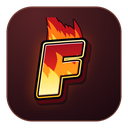

# 4th & Fury

Over-the-top arcade football for one to eight players on one screen, built with Unreal Engine 5
and Blender. Seven a side, thirty yards for a first down, no penalties, late hits allowed, and a
**Fury** meter that sets a whole team on fire.

It is an original game in the spirit of the 90s arcade football cabinets: its own name, teams,
art, sound and playbook.


| | |
| --- | --- |
|  |  |
|  |  |
|  |  |

The athletes are built in Blender by script, in three builds:


## Play it

**[Play in your browser](https://nearbycoder.github.io/4th-and-fury/play/)**: no install, keyboard or gamepads, desktop Chrome, Edge, Firefox or Safari. The [game's website](https://nearbycoder.github.io/4th-and-fury/) has the trailer, teams and controls.

Watch the [gameplay trailer](Contest/4th-and-Fury-Gameplay.mp4) or [one uninterrupted offensive drive](Contest/4th-and-Fury-One-Drive.mp4). Both have English and Brazilian Portuguese subtitles. The [play guide](Contest/Play.txt) covers the basics in two minutes.

The Mac build is not checked in (packaged apps are build output); build it with the steps below.

To build your own copy, use an Apple Silicon Mac with a source build of Unreal Engine 5.9 at `~/UnrealEngine` or set
`UE_ENGINE_DIR` to your engine directory.

```sh
cd FourthAndFury
./build.sh        # compile the game (imports the art and audio the first time)
./play.sh         # run it in a 1920x1080 window; add -fullscreen for full screen
./package.sh Shipping     # standalone app and verified distribution ZIP
```

Choose **Quick Solo** with **X** (**F** or **J**) for one-minute quarters against a Rookie opponent.
For a shared match press **A** (**G** or **K**) on the title screen. Everyone who wants to play
presses A to take a seat, steps left or right to pick a side, and presses A again when ready.
Up to four people per team; the computer runs any team nobody sits on. Leave the title screen
alone for a while and the game plays itself. Press Start or A during the demo to join.
When one person chooses both teams, lock the home team first, then choose the away team.
Back returns to the previous choice.

## Graphics and sound

Press **Y** on the title screen (**T** or **I** on a keyboard), or choose **Settings** from the pause menu.
Use the shoulders to switch tabs. Up and down select a row. Left and right adjust it. Changes apply
immediately and are saved on this device.

**Graphics** opens on Balanced. Performance lowers render scale and stadium detail. High renders at
display resolution with a second shadow-casting light bank. Ultra renders at 150% with four shadow
banks and volumetric stadium haze. You can also tune render scale, lighting, anti-aliasing, texture
detail, crowd density and particles individually. The visual quality meter summarizes those choices.
The adjacent FPS and milliseconds are measured in the current scene. Enable **Match FPS display**
to check live plays, or set a frame-rate limit and vertical sync independently of the preset.
Auto render scale follows measured GPU time and aims for 120 FPS or your lower selected cap.
The HUD stays at display resolution. Reduced Motion steadies the menu camera and disables impact
shake and stadium flashes.

**Sound** has separate controls for master volume, music, announcer, field effects, crowd and stadium,
and menu sounds. With a row selected, press **A** to hear a sample or **Y** to toggle mute.
**Announcer captions** shows the words of the current call, including when commentary is muted.
**X** restores the defaults for the open tab.

| Graphics | Sound |
| --- | --- |
|  |  |

## Controls

Any mix of controllers and the two keyboard halves works. On Mac, each controller’s face-button prompts use the markings reported by the device, including system remaps. Keyboard players see their own keys.

| | Controller | Keyboard 1 | Keyboard 2 |
| --- | --- | --- | --- |
| Move | Left stick / D-pad | W A S D | Arrow keys |
| Turbo (hold) | Either trigger | Left Shift | Right Shift |
| A | Bottom button | G or Space | K |
| B | Right button | H | L |
| X | Left button | F | J |
| Y | Top button | T | I |
| LB / RB | Shoulders | Q / E | U / O |
| Pause | Start | Esc | Enter |

| When | A | B | X | Y |
| --- | --- | --- | --- | --- |
| Calling a play | Call it | | Flip the play | |
| Before the snap (play caller) | Hike | | | |
| Quarterback | Throw to the bottom receiver | Throw to the middle receiver | Throw to the middle receiver | Throw to the top receiver |
| Ball carrier | Spin | Stiff-arm | Dive | Hurdle |
| Receiver | Call for the ball (computer QB) | Shove | Jump for the pass | Jump for the pass |
| Defender | Switch to the player nearest the ball | Big hit | Diving tackle | Swat / jump |
| Kicking | Stop the meter in the green | | | |
| After the whistle | Vote for the next play | Shove (hold Turbo for a shoulder hit) | Dive at a standing opponent or drop an elbow on a downed one | |

Both teams have three seconds after the whistle to move and hit. Players can get up and answer back. The game clock, score and ball spot are settled for the play. If everyone presses A, play calling resumes early. [Watch a kick return and the full late-hit window](Docs/after-the-whistle.mp4).

LB / RB turn the page of the playbook (pass, run & trick, kick). Receivers show the button that
throws to them above their heads. Against a computer defense, hold **LB** (**Q** or **U**) before
the snap to see the selected routes on the field. Leave the stick alone on offense or in coverage and your
athlete runs his assignment by himself. With more than one person on a team, play calling
passes to the next player every drive. A gold ring narrows toward the catch point on a pass,
punt or kickoff. White arrows at the edge of the screen point toward players outside the camera view.

In the Mac app, close the game by pressing **B** (**H** or **L** on the keyboard) on the title screen, or select **Quit Game** from the pause menu. Press **A** to confirm or **B** to cancel. **Return to Title** ends the match and keeps the game open.

The player who calls a timeout controls the pause menu. Start resumes immediately. Restarting
or leaving a match asks for a second press. If a controller disconnects during a match, the
computer plays that seat until the controller reconnects.

Press **X** in the pause menu to open the Field Guide. After a whistle, press **Y** in the pause
menu or on the final score screen to open Play Film. Follow the numbered jerseys, ball trail
and named events. Press **A** to pause or replay, use left and right to scrub, and **B** to return.
At the final score, **Y** replays the longest touchdown when either team scored one, and **X** opens Quit Game.

## The rules

* Seven on seven, 100-yard field, four quarters (1:00, 1:30, 2:00 or 3:00 each). The clock only
  runs while the ball is live.
* Four downs to make **30 yards**.
* Touchdown 6, then kick the extra point (kick meter) or go for two from the 3. Field goal 3,
  safety 2.
* Ties go to sudden death: the next score of any kind wins.
* **Fury**: big plays fill a team's meter. When it is full the team catches fire for three
  plays: faster, endless turbo, and every tackle is a big hit.
* Computer skill: Rookie, Pro or All-Fury.

## Teams

Portland Sasquatch, Honolulu Volcanoes, Anchorage Icebreakers, Memphis Hellhounds, Omaha
Twisters, Austin Amps, Tucson Scorpions and Brooklyn Gargoyles. Each has its own colours, emblem,
end zones, roster and ratings (`Art/teams.json`, `FourthAndFury/Source/FourthAndFury/FuryTeams.cpp`).

## The web version

`web/` is a browser port of the same game, built with TypeScript, [three.js](https://threejs.org) and Vite:

* `web/src/sim/` is a line-by-line port of the C++ simulation (`FurySim*`, playbook, teams, bots). Run
  `npm run simtest -- 100 0.5 8` in `web/` to play 100 headless games; the statistics track the Unreal build's.
* `web/src/game/` ports the director, broadcast camera, athlete animation blending, stadium, effects, input
  (two keyboard halves plus the Gamepad API), Web Audio mixer and Play Film.
* `web/src/hud/` draws the interface on a 2D canvas from the same 1920 x 1080 layout as the Unreal HUD.
* `web/tools/` converts the Blender exports, textures and sounds into `web/public/assets/` (glTF, WebP, MP3).

```sh
cd web
npm install
npm run dev          # http://127.0.0.1:5199/  (add ?match to skip the menus, ?demo to watch)
npm run build        # static build in web/dist
```

`site/` is the marketing site. On every push to `main`, `.github/workflows/pages.yml` builds the game and
publishes the site to GitHub Pages with the game under `/play/`.

## How it is put together

```
Art/blender/        Blender Python: the athlete (three builds), 52 animations, the stadium
Art/2d/             Team emblems, field, numbers, interface art (Python + Pillow)
Art/export/         What those scripts write: FBX meshes and clips, PNG textures, metadata
Audio/              Every sound, synthesised in Python: effects, crowd, music, announcer
FourthAndFury/      The Unreal project (C++, no Blueprints)
  Source/           FurySim* is the game itself - a plain C++ simulation with no engine types
                    in its rules; the rest draws it, feeds it input and plays its sounds
  Scripts/          import_assets.py (FBX/PNG/WAV -> Unreal assets and materials), test tools
  Content/Fury/     Imported assets (generated - rebuild with ./build.sh --assets)
web/                The browser version (TypeScript + three.js)
site/               The marketing site published to GitHub Pages
```

Rebuilding the source art (needs [Blender](https://www.blender.org) 5.x and
[uv](https://docs.astral.sh/uv/)):

```sh
blender -b --factory-startup -P Art/blender/build_player.py     # athletes
blender -b --factory-startup -P Art/blender/build_anims.py      # animations
blender -b --factory-startup -P Art/blender/build_stadium.py    # stadium, props, crowd
uv run Art/2d/make_textures.py                                  # textures
uv run Audio/make_audio.py                                      # sound
cd FourthAndFury && ./build.sh --assets                         # bring it all into Unreal
```

Each script lists its options at the top, and writes review renders to `Art/previews/`.

## Tools for working on it

```sh
Scripts/simtest.sh 200                    # play 200 computer-vs-computer games headless, print statistics
Scripts/simtest.sh 100 -FuryBots=8        # the same with eight scripted "humans" at the controls
Scripts/shoot.sh /tmp/shots 30 2 -FuryMatch -FuryBots=2    # run 30 s, a screenshot every 2 s
```

`shoot.sh` writes the game mix to `mix.wav` beside the original PNGs and smaller previews.
Set `FURY_APP=Packaged/FourthAndFury.app` to capture a packaged build, or `FURY_SOUND=1`
to play audio through the speakers. Set `FURY_CAPTURE_FPS=60` for a fixed 60-frame-per-second recording clock in either build. Reusing the output folder replaces the previous capture and keeps unrelated files.

Both launchers accept `-FuryMatch` (skip the menus),
`-FuryBots=N` (scripted players), `-FuryHome=<team> -FuryAway=<team>`, `-FuryQuarter=<seconds>`,
`-FuryScreen=lobby|teams`, `-FuryViewer` (animation viewer; `-FuryClip=<name>`), `-FuryTestFury`,
`-FuryTestKick`, `-FuryTestFinal`. The game log is `~/Library/Logs/FourthAndFury/FourthAndFury.log`
(the packaged app is sandboxed, so its log is under
`~/Library/Containers/com.fourthandfury.FourthAndFury/Data/Library/Logs/FourthAndFury/`).

## Measure frame rate

From `FourthAndFury`, run the packaged game through a seeded match with eight scripted seats.

```sh
FURY_SCALE=auto Scripts/benchmark.sh 7341 75
FURY_FULLSCREEN=1 Scripts/benchmark.sh 7341 75
Scripts/benchmark.sh 11939 50 -FuryTestFury
```

Each run requests a 1920×1080 viewport at 100% render scale, plays normal audio, and prints the
actual viewport, field scale and preset. Set `FURY_SCALE=auto` to benchmark the saved preset’s own render scale. The first five seconds allow for startup. The log reports average FPS
and median, 95th-percentile, 99th-percentile and worst frame times for both the match and live
ball play. GPU timing appears separately when Metal supplies it. Capturing screenshots and
running other GPU workloads can affect the result. Fullscreen uses the display mode macOS selects.

These measurements used the Shipping renderer on a 40-core GPU Apple M5 Max. Each 1080p run used eight scripted seats, normal sound and a 144 FPS cap. One to three other Unreal games were running when the tests started. Performance ran three times for 75 seconds on the same match. Balanced ran for 60 seconds on two different seeds. High and Ultra each ran for 45 seconds.

| Preset | Field scale at finish | Average live FPS | Live 95th-percentile frame time |
| --- | --- | ---: | ---: |
| Performance | 75% | 109.1–115.0 | 12.5–13.9 ms |
| Balanced | Auto, 100% | 111.6–115.2 | 12.6–13.1 ms |
| High | 100% | 111.5 | 13.4 ms |
| Ultra | 150% | 106.1 | 12.2 ms |

The final distribution ZIP was also extracted and timed with no other Unreal games running at the start. At 1920×1080, live play averaged **116.25 FPS** on Performance and **112.68 FPS** on Balanced. At the Mac display’s 2064×1347 fullscreen size, Balanced averaged **119.50 FPS** with an 8.54 ms 95th-percentile frame and 80% field scale. A separate fullscreen run under load averaged 119.56 FPS with a 10.18 ms 95th-percentile frame. A sustained 120 FPS requires an 8.33 ms frame.

## Build and controller verification

The Shipping archive runs offline on Apple Silicon Macs running macOS 14 or later. It uses an ad-hoc signature and includes the play guide. For a standard Gatekeeper launch after downloading from the web, the publisher still needs to sign with Developer ID and notarize the application.

On macOS the game reads gamepads directly through Apple’s GameController framework. On other platforms the project uses Unreal’s per-device input. Two keyboard players completed the join, team selection, match and quit flow in the extracted Shipping build. Eight-seat games were exercised with scripted inputs. Eight physical controllers and console builds still need device testing.

Twelve Unreal automation checks cover possession and scoring, the three-second whistle, Fury duration, play film, input edges, mapped controller glyphs and reconnection, frame scaling, captions and jersey numbers. Six hundred simulated games across Rookie, Pro and All-Fury completed with a winner. The Blender checker passes all 52 clips, and all 139 WAV files pass the project’s audio checks.

A rendered Development build completed four consecutive default-length games with eight scripted seats and three rematches in one launch. The games ran for 100, 99, 104 and 94 plays. In a separate check of the extracted Shipping app, keyboard input selected and flipped a play, snapped, targeted a receiver, triggered late-hit controls and opened the replay.

## Player and stadium detail

The [editable cover shoot](Art/blend/Press-Key-Art-Players.blend) opens in Blender with both athletes posed, the ball attached to the runner’s tuck socket, and the uniform textures packed.

The close-up athlete uses articulated gloves and sculpted jersey folds. A damped spring drives the loose
towel hem and the jersey folds between the belt and chest pads. During spins, jukes, hurdles, stumbles and blocks, the game uses a grounded toe as a
pivot and adjusts the hip-to-ankle chain within reach. Carrier footfalls follow the gait cycle.

The stadium has glazed plaza entrances and seated spectators with chairs on their own tread.
Athletes, the bowl, props and spectators have three mesh detail levels.

## Credits and licences

* Fonts: Barlow Condensed, Anton and Graduate (SIL Open Font License; licence texts in
  `FourthAndFury/Content/Fonts`), plus the display faces in `Art/fonts` used to draw the emblems.
* The announcer and field vocals use saved performances generated with the Ryan preset in
  Qwen3-TTS-12Hz-1.7B-CustomVoice. See `Audio/make_takes.py` for the model and delivery instructions.
* Everything else - models, animation, textures, sound effects, crowd and music - is generated
  by the scripts in this repository.

Created in [T3 Code](https://t3.codes).
